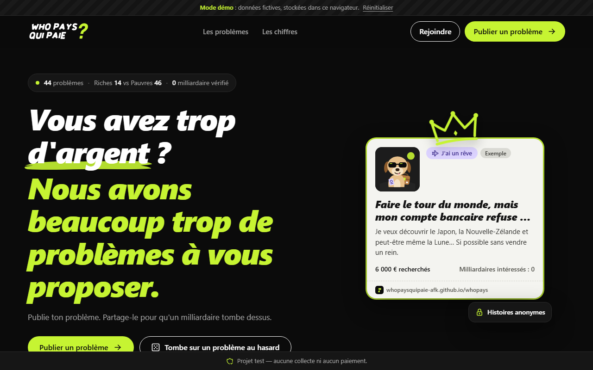
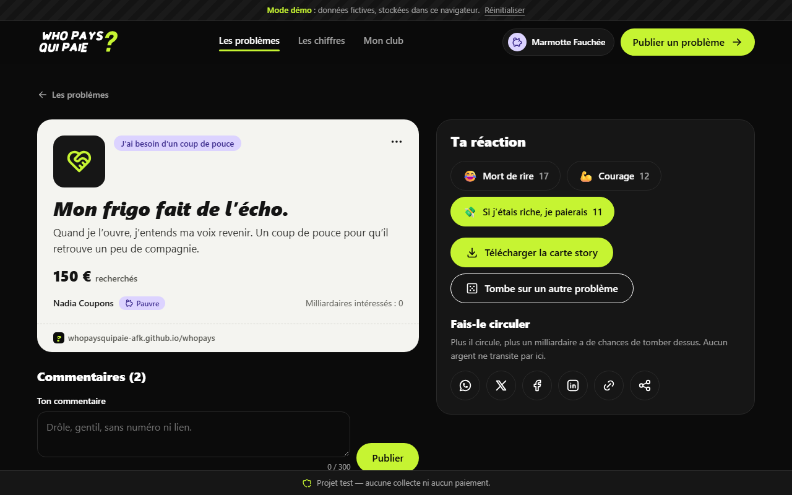
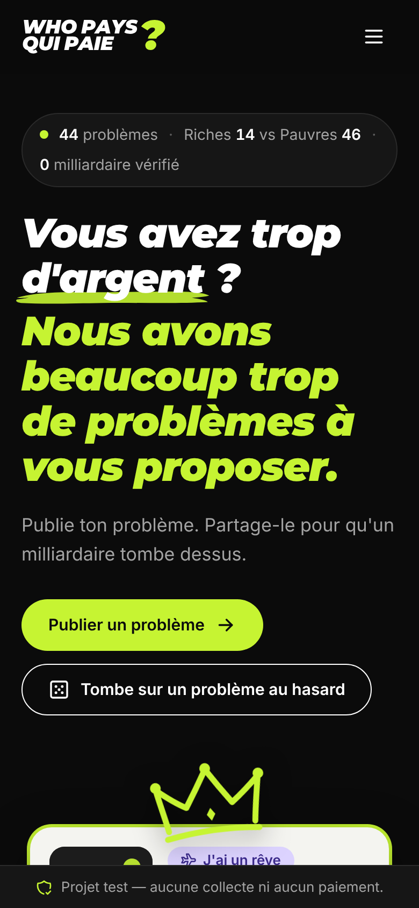
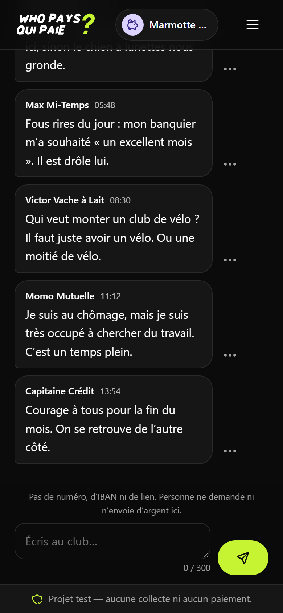
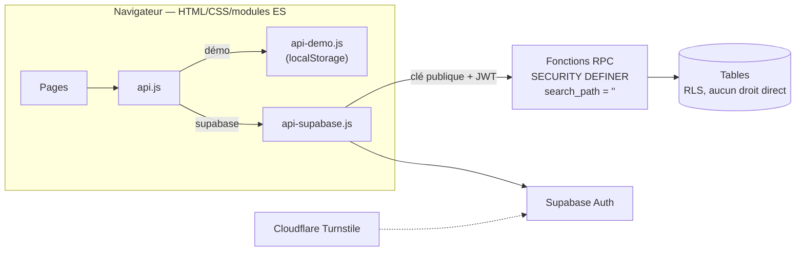

<div align="center">

<picture>
  <source media="(prefers-color-scheme: dark)" srcset="site/assets/img/logo.svg">
  
</picture>

### Vous avez trop d'argent ? Nous avons beaucoup trop de problèmes à vous proposer.
**La première plateforme où les milliardaires trouvent enfin des problèmes à leur mesure. C'est une blague. Enfin, presque.**

[](LICENSE)
[](https://whopaysquipaie-afk.github.io/whopays/)
[](https://whopaysquipaie-afk.github.io/whopays/?demo=1)
[](CONTRIBUTING.md)
[](#-aucun-argent-jamais)

**[👉 Ouvrir le site](https://whopaysquipaie-afk.github.io/whopays/)** · **[Démo](https://whopaysquipaie-afk.github.io/whopays/?demo=1)** (données fictives, rien n'est enregistré sur un serveur) · [English version](README.md)



</div>

---

## Pourquoi

Les sites de financement participatif, c'est des barres de progression, de la culpabilité et des frais. **Qui paie ?** en fait un jeu :

- **Chacun publie son problème** — un voyage rêvé, une facture EDF qui connaît mieux ton adresse que tes amis, un patron qui signe ses e-mails « Bisous ».
- **Deux camps s'affrontent** : les **Riches** 👑 (de l'argent mais pas assez de problèmes) et les **Pauvres** 🐷 (plein de problèmes et zéro milliardaire).
- **Tout le monde partage** : plus un problème circule, plus un milliardaire a de chances de tomber dessus.

Et ensuite… rien. **0 € financé.** C'est la blague, l'expérience sociale, et ce qui rend le site sûr : aucun paiement, aucune cagnotte, aucun montant « collecté ». Jamais.

## Fonctionnalités

| | |
|---|---|
| 🏠 **Accueil en direct** | Compteurs qui défilent, match Riches vs Pauvres avec la vraie barre de rapport de force, 10 catégories, le mur des problèmes |
| ⚡ **Rejoindre en 10 secondes** | Un camp, un pseudo, un e-mail. Pas de mot de passe. Confettis aux couleurs du camp |
| 📝 **Publication immédiate** | Un problème qui passe les filtres est en ligne dans la seconde, prêt à partager. Les cas sensibles (détresse, violence, maladie…) attendent une relecture humaine, qui peut réorienter vers une page d'aide réelle |
| 😂 **Réactions et commentaires** | « Mort de rire », « Courage », « Si j'étais riche, je paierais » |
| 📱 **Carte story** | Un clic → une image 1080×1920 prête pour Instagram, TikTok ou WhatsApp |
| 🔒 **Clubs par camp** | Un salon par camp. Les pauvres ne lisent pas le club des riches, et inversement (garanti en SQL) |
| 📊 **Les chiffres** | « X € de problèmes en attente d'un milliardaire. **0 € financé.** » |
| 🎲 **Problème au hasard** | Parce que faire défiler, c'est pour ceux qui ont le temps |
| 🚩 **Auto-modération** | 3 signalements masquent un contenu ; un membre bloqué peut lire mais plus écrire |
| 📲 **Application installable** | Manifeste + service worker (fichiers statiques uniquement) |
| 🧪 **Mode démo** | Tout le site tourne dans le navigateur avec 60 membres fictifs, sans serveur. Sur le site en ligne : ajouter `?demo=1` à l'adresse (ou « Essayer la démo » en pied de page) |

<div align="center">



</div>

## Comment ça marche

1. **Choisis ton camp en 10 secondes.** Riche ou pauvre, un pseudo, un e-mail. Pas de mot de passe.
2. **Publie ton problème.** Il passe nos filtres et il est en ligne dans la seconde.
3. **Partage-le.** Plus il circule, plus un milliardaire a de chances de tomber dessus.

Côté technique : connexion anonyme instantanée (Supabase Auth + Turnstile), e-mail de confirmation non bloquant, puis toutes les lectures et écritures passent par des fonctions SQL. Détails dans [docs/ARCHITECTURE.md](docs/ARCHITECTURE.md).



## Pile technique

- **Site :** HTML, CSS, JavaScript (modules ES). **Aucun framework, aucun npm, aucune étape de build.**
- **Serveur :** [Supabase](https://supabase.com) (Postgres + Auth), région UE, accessible **uniquement par des fonctions RPC**.
- **Anti-robots :** Cloudflare Turnstile · **Mesure d'audience :** Cloudflare Web Analytics (sans cookie, facultatif)
- **E-mails :** SMTP Brevo · **Hébergement :** GitHub Pages via GitHub Actions

## Essayer en local, en mode démo

```bash
git clone https://github.com/whopaysquipaie-afk/whopays.git && cd whopays && python -m http.server 8080 --directory site
```

Ouvrir http://localhost:8080/?demo=1. Tout fonctionne avec des données fictives stockées dans le navigateur (sans `?demo=1`, le site parle au projet Supabase indiqué dans `config.js`). Pour se connecter comme un membre fictif : *Déjà membre ?* → `membre1@exemple.invalid`. Tests : http://localhost:8080/tests.html?demo=1.

## Déployer ta propre version en 10 minutes

1. **Forker** ce dépôt.
2. **Supabase :** créer un projet (UE), exécuter les 4 fichiers de `supabase/migrations/` puis les 2 fichiers de `supabase/seed/` dans l'éditeur SQL, activer la connexion anonyme. Lancer `supabase/tests/verif_securite.sql` : chaque ligne doit afficher OK.
3. **Configurer :** dans `site/assets/js/config.js`, mettre `MODE: 'supabase'`, ton `SITE_URL`, l'URL et la clé publique Supabase. Déposer le build UMD de `supabase-js` v2 dans `site/assets/vendor/`. Lancer `node tools/sync-url.mjs`.
4. **GitHub Pages :** *Settings → Pages → Source : GitHub Actions*. Pousser sur `main`. C'est en ligne.

Turnstile, Brevo et les modèles d'e-mails en français : [docs/CONFIGURATION.md](docs/CONFIGURATION.md). Modération quotidienne : [docs/MODERATION.md](docs/MODERATION.md).

## Sécurité

- **RLS sur toutes les tables, aucun droit direct** pour `anon` et `authenticated`.
- **20 fonctions RPC** `SECURITY DEFINER` avec `search_path` vide, validation des entrées, messages d'erreur en français.
- **Filtres côté serveur** (mots interdits, téléphones, IBAN, e-mails, liens), reproduits dans le navigateur pour un retour immédiat — vérifiés identiques.
- **Limites :** 3 problèmes / 24 h, 10 commentaires / h, 30 messages de club / h, 20 signalements / h. **3 signalements masquent** un contenu.
- **Cloisonnement des camps garanti en SQL.**
- **Aucun `innerHTML`**, un constructeur de DOM qui refuse les URL `javascript:`, une CSP stricte sur chaque page.
- **Recherche de secrets :** `gitleaks` à chaque push, et `tools/verif.mjs` analyse les fichiers *et tout l'historique Git*.

Une faille ? Voir [SECURITY.md](SECURITY.md).

## 🚫 Aucun argent, jamais

C'est un **projet test**. Rien n'est collecté, rien n'est payé, rien n'est promis. Partager un problème apporte de la visibilité, pas un financement. Les montants sont indicatifs. Si tu traverses une vraie difficulté, le site a une [page d'aide réelle](site/aide.html), sobre et sans humour.

## Contribuer

Les contributions sont bienvenues — surtout des problèmes fictifs drôles, de l'accessibilité et des tests. Lire [CONTRIBUTING.md](CONTRIBUTING.md), puis choisir une [première contribution](docs/ROADMAP.md#good-first-issues).

## Feuille de route

Fil en direct, badges, classements, défi de la semaine, profils publics… Voir [docs/ROADMAP.md](docs/ROADMAP.md).

## Licence

[AGPL-3.0](LICENSE).

Site édité par Hassen Bamri · Hébergé par GitHub · Projet test sans collecte d'argent.

<div align="center"><sub>Fait avec beaucoup trop de problèmes et pas assez de milliardaires. ⭐ Une étoile, c'est gratuit — contrairement à tout le reste.</sub></div>
