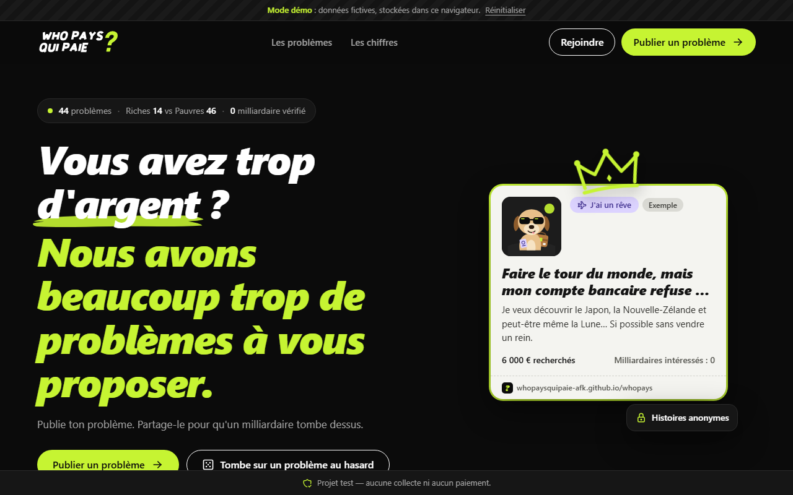
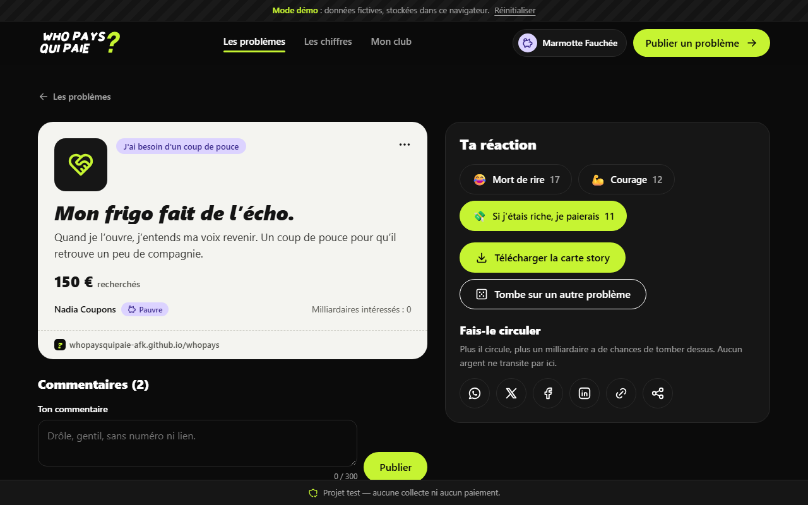
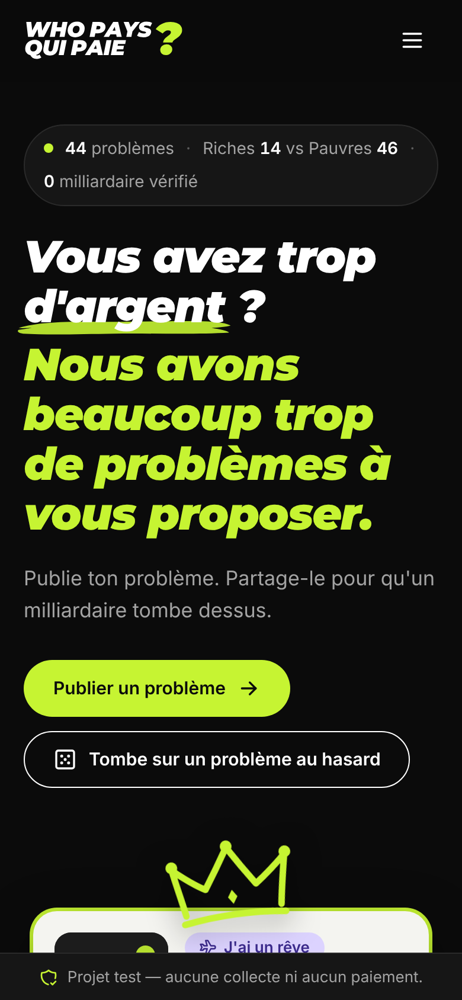
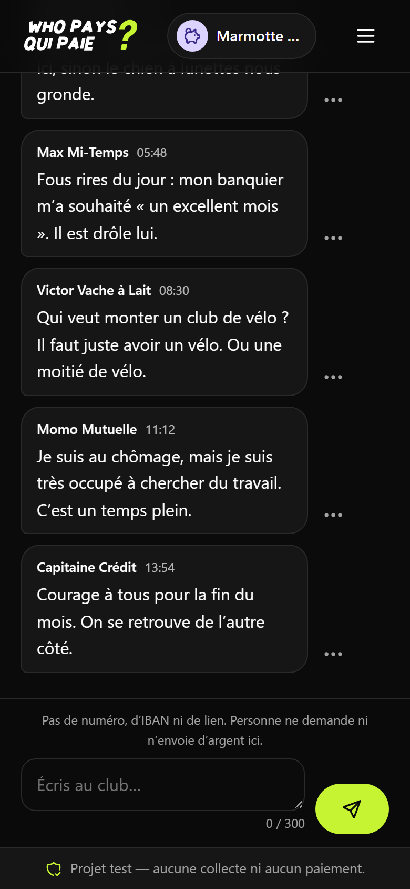
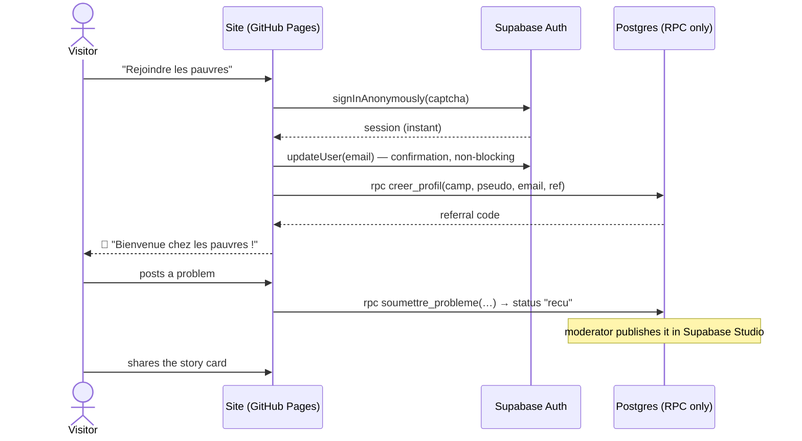
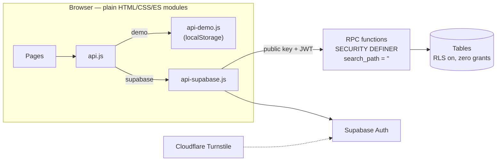

<div align="center">

<picture>
  <source media="(prefers-color-scheme: dark)" srcset="site/assets/img/logo.svg">
  
</picture>

### The first platform where billionaires can finally find problems worth their money.
**It's a joke. Mostly.**

[](LICENSE)
[](https://whopaysquipaie-afk.github.io/whopays/)
[](https://whopaysquipaie-afk.github.io/whopays/?demo=1)
[](CONTRIBUTING.md)
[](#stack)
[](#-no-money-ever)

**[👉 Open the site](https://whopaysquipaie-afk.github.io/whopays/)** · **[Live demo](https://whopaysquipaie-afk.github.io/whopays/?demo=1)** (fictional data, nothing is saved on a server) · [Version française](README.fr.md)



</div>

---

## Why

Crowdfunding sites are full of progress bars, guilt and fees. **Qui paie ?** ("Who pays?") flips it into a game:

- **People post their problems** — a dream trip, an electricity bill that knows their address better than their friends, a boss who signs his e-mails "Bisous".
- **Two camps face off**: the **Rich** 👑 (they have money but not enough problems) and the **Poor** 🐷 (plenty of problems, zero billionaires).
- **Everyone shares** — the more a problem travels, the more likely a billionaire stumbles upon it.

And then… nothing happens. **0 € funded.** That's the joke, the social experiment, and the reason it's safe: no payment, no donation link, no "collected" amount. Ever.

## Features

| | |
|---|---|
| 🏠 **Live home** | Counters that roll in, the Rich vs Poor match with a real tug-of-war bar, 10 categories, an infinite wall of problems |
| ⚡ **Join in 10 seconds** | Pick a camp, a pseudo, an e-mail. No password. Confetti in your camp's color |
| 📝 **Moderated posting** | Every problem is reviewed before going live; serious distress is redirected to a real-help page |
| 😂 **Reactions & comments** | "Mort de rire", "Courage", "Si j'étais riche, je paierais" — with instant toggles |
| 📱 **Story card** | One tap → a 1080×1920 PNG ready for Instagram/TikTok/WhatsApp, shared natively on mobile |
| 🔒 **Camp clubs** | One group chat per camp. The Poor can't read the Rich club, and vice versa (enforced in SQL) |
| 📊 **Les chiffres** | "X € of problems waiting for a billionaire. **0 € funded.**" |
| 🎲 **Random problem** | Because scrolling is for people with time |
| 🚩 **Self-moderation** | 3 reports auto-hide any content; blocked members can read but not write |
| 📲 **Installable** | Manifest + service worker (static files only) |
| 🧪 **Demo mode** | The whole site runs in your browser with 60 fictional members — no backend needed. On the live site, add `?demo=1` to any URL (or click *Essayer la démo* in the footer) |

<div align="center">



</div>

## How it works



## Architecture



More in [docs/ARCHITECTURE.md](docs/ARCHITECTURE.md).

## Stack

- **Front-end:** HTML, CSS, JavaScript ES modules. **No framework, no npm, no build step.**
- **Back-end:** [Supabase](https://supabase.com) (Postgres + Auth), EU region, accessed **only through RPC functions**.
- **Anti-bot:** Cloudflare Turnstile · **Analytics:** Cloudflare Web Analytics (cookieless, optional)
- **E-mails:** Brevo SMTP · **Hosting:** GitHub Pages via GitHub Actions
- **Icons:** Tabler-style strokes (MIT) · **Fonts:** Montserrat + Inter, self-hosted

## Try it locally in demo mode

```bash
git clone https://github.com/whopaysquipaie-afk/whopays.git && cd whopays && python -m http.server 8080 --directory site
```

Open http://localhost:8080/?demo=1. Everything works with fictional data stored in your browser (without `?demo=1`, the site talks to the Supabase project set in `config.js`). Sign in as an existing fictional member with *Déjà membre ?* → `membre1@exemple.invalid`. Run the test suite at http://localhost:8080/tests.html?demo=1.

## Deploy your own in 10 minutes

1. **Fork** this repo.
2. **Supabase:** create a project (EU), run the 4 files of `supabase/migrations/` then the 2 seeds in the SQL editor, enable anonymous sign-ins. Run `supabase/tests/verif_securite.sql`: every line must say OK.
3. **Configure:** in `site/assets/js/config.js` set `MODE: 'supabase'`, your `SITE_URL`, Supabase URL and public key. Drop the `supabase-js` v2 UMD build into `site/assets/vendor/`. Run `node tools/sync-url.mjs`.
4. **GitHub Pages:** *Settings → Pages → Source: GitHub Actions*. Push to `main`. Done.

Turnstile, Brevo and the French e-mail templates are covered step by step in [docs/CONFIGURATION.md](docs/CONFIGURATION.md).

## Security

The repository is public and the site handles real e-mail addresses, so security is the serious part of the joke:

- **Row Level Security on every table and zero direct grants** to `anon` / `authenticated`. Nobody can `select * from profiles`.
- **20 RPC functions**, all `SECURITY DEFINER` with `SET search_path = ''`, input validation, French error messages.
- **Server-side filters** (banned words, phone numbers, IBANs, e-mails, links) mirrored in the browser for instant feedback — tested to give identical results.
- **Rate limits:** 3 problems / 24 h, 10 comments / h, 30 club messages / h, 20 reports / h. **3 reports hide** any content.
- **Camp isolation enforced in SQL**: a club query only ever returns the caller's camp.
- **No `innerHTML`**, a DOM builder that refuses `javascript:` URLs and inline handlers, and a strict CSP on every page.
- **Secret scanning:** `gitleaks` on every push, and `tools/verif.mjs` scans the files *and the whole Git history*.
- `supabase/tests/verif_securite.sql` — 100+ checks (direct table access, private data leaks, club isolation, limits, filters, blocking, auto-masking).

Found something? See [SECURITY.md](SECURITY.md).

## 🚫 No money, ever

This is a **test project**. Nothing is collected, nothing is paid, nothing is promised. Sharing a problem brings visibility, not funding. Amounts are indicative and never connected to any payment method. If you are going through a real hardship, the site has a sober [real-help page](site/aide.html).

## Contributing

PRs welcome — especially funny fictional problems, accessibility fixes and tests. Read [CONTRIBUTING.md](CONTRIBUTING.md), then pick a [good first issue](docs/ROADMAP.md#good-first-issues).

```bash
sh tools/check.sh   # contract tests + static checks, must be green
```

## Roadmap

Live feed, badges, leaderboards, challenge of the week, public profiles… See [docs/ROADMAP.md](docs/ROADMAP.md).

## License

[AGPL-3.0](LICENSE) — if you run a modified version as a service, share your changes.

Site published by Hassen Bamri. Hosted by GitHub. A test project without any money collection.

<div align="center"><sub>Made with too many problems and not enough billionaires. ⭐ Star it — it's free, unlike everything else.</sub></div>
