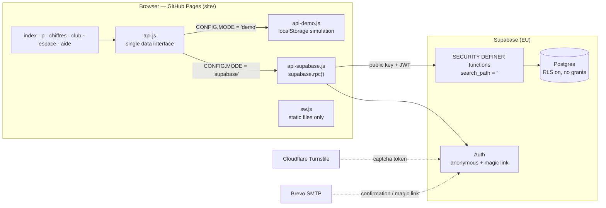

# Architecture

> Plain HTML, CSS and ES modules on GitHub Pages. Supabase behind RPC functions only. No build step.

## Overview



## Principles

| Principle | How |
|---|---|
| **No build** | Every file under `site/` is served as-is. ES modules, `import`/`export`, dynamic `import()` for rarely used code (auth dialogs, story card, demo backend). |
| **One data interface** | Pages only talk to `api.js`. It loads `api-demo.js` or `api-supabase.js` according to `CONFIG.MODE`. Both expose the same methods, arguments, return shapes and French error messages. |
| **Zero trust in the browser** | Tables have RLS enabled and **no grant** to `anon`/`authenticated`. Every read and write is a `SECURITY DEFINER` function with `SET search_path = ''`, input validation, content filters, rate limits and blocked-member checks. |
| **Safe DOM** | No `innerHTML`. Every node is built by `h()` (`ui.js`) with `textContent`; `h()` refuses `on*` strings, `javascript:`/`data:` URLs and dangerous tags (`dom-safe.js`). Strict CSP `<meta>` on every page. |
| **Relative paths** | The site lives under `/whopays/`: every link and asset is relative. The public URL exists in one place only: `CONFIG.SITE_URL`. |
| **Same rules twice** | Filters live in `filtres.js` (instant feedback in forms + demo backend) and in SQL (`wp_raison_filtre`). The contract test suite runs against the demo backend; `verif_securite.sql` runs against Postgres. |

## Files

```
site/
├── *.html                 pages (static markup, CSP, Open Graph)
├── manifest.webmanifest   installable app (start_url and scope "./")
├── sw.js                  caches static files only, never API responses
└── assets/
    ├── css/style.css      design system (tokens, components, pages)
    ├── img/               SVG brand assets + PNG icons (masters in img/src/, generated by tools/images.mjs)
    └── js/
        ├── config.js      MODE, SITE_URL, public keys
        ├── api.js         facade → api-demo.js | api-supabase.js (+ supabase.js client loader)
        ├── filtres.js     banned words, phone, IBAN, e-mail, link filters
        ├── page.js        bootstrap shared by every page (session, intents, reveal, SW)
        ├── layout.js      header, footer, banners, rules dialog, install link
        ├── ui.js          h(), dialogs, toasts, "…" menus, formatting
        ├── auth.js        join in 10 s, magic link · publier.js (publish form) · turnstile.js
        ├── carte.js       problem card · mur.js wall · reactions.js · commentaires.js · signalement.js
        ├── story.js       1080×1920 canvas story card
        ├── club.js · espace.js · partage.js · parrainage.js · animations.js · champs.js
        ├── moderation.js  data layer of the private moderation page (mod_* RPC | demo)
        ├── pages/         one entry module per page
        └── tests/contrat.js  API contract suite (Node + browser)
supabase/
├── migrations/001_schema.sql · 002_securite.sql · 003_fonctions.sql · 004_moderation.sql · 005_publication_auto.sql · 006_moderateurs.sql · 007_mots_sensibles_v2.sql
├── seed/exemples.sql · seed/mots_interdits.sql
└── tests/verif_securite.sql
tools/
├── test.mjs     contract suite in Node (in-memory localStorage)
├── verif.mjs    static checks: syntax, unsafe DOM, absolute links, CSP, secrets (files + git history), assets, JS budget
├── images.mjs   regenerates the brand SVGs (icons, masters); the logo is a source file it embeds
├── sync-url.mjs writes CONFIG.SITE_URL into the Open Graph tags
└── polices.mjs  wires the woff2 fonts once they are added
```

## Data model (summary)

| Table | Purpose |
|---|---|
| `moderateurs` | members allowed to use `moderation.html` (filled in the SQL editor only; `mod_*` functions check it) |
| `profiles` | one member: pseudo, e-mail, camp (`riche`/`pauvre`), newsletter, referral code, `bloque` |
| `problems` | category, title, text, optional amount, status `recu` → `publie` / `refuse` / `reoriente`, `masque` |
| `reactions` | `rire` · `courage` · `paierais`, one of each per member and problem |
| `comments` | 300 chars, can be masked by reports, by the problem author or by the admin |
| `club_messages` | one room per camp; the camp is copied from the profile at send time |
| `reports` | one per member and target; the 3rd report masks the target |
| `verifications` | verified billionaires (filled from Studio only — currently: 0) |
| `mots_interdits` | banned words, editable in Studio |
| `mots_sensibles` | sensitive expressions (distress, violence, illness…): the problem waits for a human review instead of going live |
| `reglages` | site settings, e.g. `publication_auto` (`true` = immediate publication, `false` = pre-moderation) |

## Request flow: publishing a problem

`public.soumettre_probleme` validates the fields, applies the filters and the rate limit (3 per 24 h), then:
- **`publie`** at once when `reglages.publication_auto` is `true` and no sensitive expression appears in the title or the text — the author gets « C'est en ligne ! » with share buttons and the story card;
- **`recu`** otherwise — a moderator publishes, refuses or redirects it (`docs/MODERATION.md`); the author sees « Reçu ! » and a link to the help page.

A member can never choose the status. A missing setting means pre-moderation (safe default).

## Request flow: reacting to a problem

1. `reactions.js` toggles the button immediately (optimistic UI).
2. `api.reagir(id, 'rire')` → `api-supabase.js` → `supabase.rpc('reagir', { p_problem_id, p_type })`.
3. `public.reagir` checks: caller authenticated, profile exists, not blocked, problem published and not masked, valid type. It toggles the row and returns the three counters.
4. The UI reconciles with the returned counters, or rolls back and shows the French error.

## Demo mode

`api-demo.js` keeps a full fake database in `localStorage` (`whopays_demo_v1`): 60 fictional members, 7 examples, 44 problems, reactions, comments and club messages. It applies the same validation, filters, limits, camp isolation, auto-masking and blocking as the SQL functions. `window.demoAdmin` exposes moderation helpers (`publier`, `refuser`, `reorienter`, `bloquer`, `verifier`, `masquer`, `setPublicationAuto`) for testers. The sensitive words of the demo live in `mots-sensibles.js` (loaded by the demo backend only; `tools/verif.mjs` checks the list is identical to the SQL seed).

## Service worker and deploys

- `sw.js` only handles same-origin static files; Supabase, Turnstile and analytics requests are never intercepted.
- Pages, JavaScript, CSS and the manifest are **network first** (revalidated with the server, `cache: 'no-cache'`); the cache is only an offline fallback. Fonts and images are **stale-while-revalidate**.
- The cache name is `whopays-__BUILD__`: `deploy.yml` replaces `__BUILD__` with the short commit SHA before uploading `site/`, so every deploy installs a new worker and deletes the old cache. Locally the placeholder stays as is.
- When a new worker takes control of an open page (`controllerchange`), `layout.js` reloads it **once** (30 s guard in `sessionStorage`), so a page never runs a mix of old and new files. No reload on the very first install.
- `moderation.html` and its scripts are never cached.

## Known limits

| Limit | Consequence | Mitigation |
|---|---|---|
| Same link preview for every problem | WhatsApp/LinkedIn show the general image | Title in the shared text, story card, watermark on every card |
| Unconfirmed account tied to one browser | Clearing the browser loses access | "Confirm your e-mail" reminder in Mon espace |
| Clubs refreshed every 4 s | Small delay | Realtime is on the roadmap |
| Free Supabase project paused after inactivity | No data while paused | Traffic keeps it alive; one-click resume |
| `404.html` uses relative paths | A deep unknown URL (`/whopays/a/b`) renders without styles | Unknown first-level URLs work; deep links are not generated by the site |
